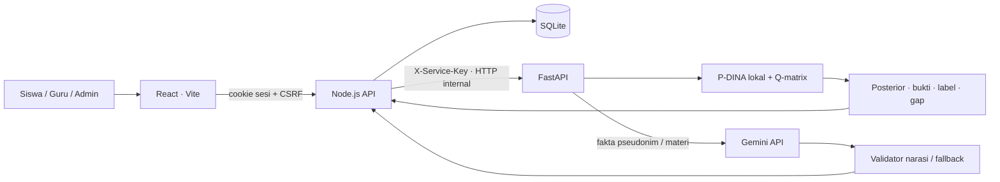

# EduBridge — penjelasan dan snapshot sistem

Iterasi ini menghubungkan konfigurasi Gemini yang sudah diisi, melengkapi secret antarlayanan dan akun operator, menguji layanan langsung, dan merapikan tampilan rumus matematika di seluruh alur belajar. Aplikasi tetap berfokus pada deteksi dan pengurangan learning gap matematika kelas XI melalui CDA dan CDM P-DINA sebelum serta sesudah pembelajaran kelas.

## Membuka hasil

- Aplikasi: http://127.0.0.1:5173
- Swagger AI: http://127.0.0.1:8000/docs
- Galeri dan diagram: [SNAPSHOT.html](SNAPSHOT.html)
- Ringkasan verifikasi: [snapshots/verification-summary.json](snapshots/verification-summary.json)
- Panduan lengkap: [README.md](README.md)
- Kredensial lokal: `CREDENTIALS.local.txt` di root; file privat ini diabaikan Git dan Docker.
- Konfigurasi aktif: `server/.env`. API key pengguna dipertahankan dan tidak disalin ke screenshot atau laporan.

## Hubungan frontend, backend, dan AI

### Frontend — `client/`

Ruang siswa berisi jalur belajar, katalog, materi penguatan, kuis, pembahasan, progres, profil, maskot, XP, level, streak, dan lencana. Tema tersimpan dalam cookie. Guru memiliki pengaturan fase kelas, peta atribut, detail hasil, ekspor, dan ringkasan pretest/posttest. Admin mengelola pengguna, materi, bank soal, publikasi, dan status layanan. Screenshot memperlihatkan aplikasi aktual, termasuk tema gelap, dengan viewport desktop landscape 1600×1000 dan skala gambar 1,5.

#### Pengelolaan materi kelas

Menu **Kelola materi** tersedia untuk guru dan admin. Guru membuat, mengedit, menerbitkan, dan menghapus materi untuk kelas yang dikelolanya; admin juga mengelola materi umum. Editor mendukung beberapa bagian, rumus LaTeX, penjelasan bertahap, contoh berlangkah, miskonsepsi, dan latihan mandiri. Ikon dipilih secara deterministik dari enam ilustrasi katalog berdasarkan judul dan topik, dengan aturan yang sama untuk pratinjau frontend dan penyimpanan backend (`shared/materialIcons.js`).

Materi terbit tampil pada katalog siswa dan topik penguatan terkait; draf hanya dapat dibaca pengelola. Materi bawaan dapat disalin untuk disesuaikan dengan kebutuhan kelas. Penambahan materi tetap terhubung ke topik asesmen terkalibrasi tanpa mengganti pertanyaan, fingerprint instrumen, parameter PDINA, atau riwayat siswa. Penghapusan bersifat logis dan diaudit; edit/hapus memakai versi untuk menolak perubahan yang sudah kedaluwarsa. Validasi dan otorisasi dijalankan di backend, di dalam transaksi bersama audit. Migrasi tabel berjalan otomatis saat database dibuka.

Verifikasi iterasi materi: build produksi berhasil; 33 tes backend lulus, termasuk enam tes baru untuk CRUD, cakupan kelas, izin, versi, validasi, audit, dan persistensi. Seluruh 16 skenario browser terverifikasi: 15 lulus pada regresi terakhir dan satu skenario login awal yang timeout lulus saat diulang. Tes kini menunggu respons autentikasi/pengumpulan asesmen secara eksplisit dan tetap memeriksa HTTP 200. Materi baru diuji pada desktop dan ponsel 320–390 px, termasuk mode gelap, ikon, rumus, latihan, draf, publikasi, edit, dan hapus. Pengujian memakai database terisolasi; data pengguna tidak diubah.

#### Generator dan validasi materi

Generator materi AI tersedia untuk seluruh materi atau setiap bagian editor. Backend meneruskan konteks materi terbaru dan atribut topik ke FastAPI, yang meminta JSON terstruktur dari Gemini serta memvalidasinya dengan Pydantic. Bank soal, kunci asesmen, identitas akun, dan diagnosis siswa tidak dimasukkan ke prompt. Setiap hasil merupakan draf, bukan materi terbit. Publikasi memerlukan konfirmasi peninjauan guru/pengelola; backend mencatat peninjau, waktu, dan hash isi. Perubahan isi, kelas, atau topik memerlukan validasi ulang. Gangguan AI dan pembatalan menjaga tulisan manual tetap utuh. Endpoint dan skema generator tersedia di Swagger, tanpa retraining model PDINA.

Generator telah diuji langsung dengan Gemini yang dikonfigurasi untuk satu bagian dan tiga bagian. Keduanya menghasilkan HTTP 200; penyimpanan draf berhasil, publikasi tanpa peninjauan ditolak (`422`), publikasi dengan konfirmasi diterima, dan perubahan setelah peninjauan kembali ditolak tanpa validasi ulang. Ketiga bagian keluaran terakhir memuat 105 ekspresi matematika yang dapat dirender KaTeX tanpa kesalahan sintaks. Ini memverifikasi mekanisme dan tampilan, bukan menggantikan pemeriksaan kebenaran matematika oleh guru. Pengujian publikasi memakai database dalam memori dan tidak menerbitkan draf ke kelas pengguna. Regresi backend terbaru: 36 lulus; AI: 93 lulus, satu tes opsional dilewati.

Regresi browser iterasi generator: seluruh 18 skenario lulus dalam satu eksekusi, termasuk dua skenario generator untuk pengisian seluruh/per bagian, pratinjau rumus, draf privat, validasi ulang, gangguan provider, dan pembatalan. Build produksi berhasil; lint tidak menemukan error (peringatan lama masih ada). Frontend lokal, API aplikasi, dan Swagger generator juga merespons HTTP 200 setelah stack pengembangan dimuat ulang.

Setiap bagian editor juga mempunyai pratinjau dengan renderer yang sama seperti halaman siswa, termasuk rumus dan pembahasan latihan. Gunakan pratinjau sebelum mengonfirmasi validasi. Panduan generator dan perintah uji live tersedia di README; hasil uji live terakhir dan contoh draf berada di `artifacts/` lokal yang diabaikan Git.

#### Rendering matematika dalam materi dan asesmen

Rumus dirender dengan KaTeX pada teks soal, pilihan jawaban, pembahasan setelah pengumpulan, materi penguatan, pratinjau editor bank soal admin, tutor, dan narasi. Bank soal lama memakai notasi Unicode seperti `(x − 6)/2`, `√(13² − 5²)`, `f⁻¹(6)`, `(f ∘ g)(x)`, dan `[[2, 1], [3, 4]]`; `client/src/lib/mathText.js` mengubahnya menjadi pecahan, akar, pangkat, komposisi/invers, dan matriks **pada lapisan presentasi saja**. Kalimat Indonesia tetap teks biasa, dan teks asli selalu dapat direkonstruksi utuh dari segmen tampilan. Karena teks soal, kunci, snapshot, Q-matrix, dan fingerprint instrumen tidak diubah, kalibrasi PDINA tetap berlaku dan tidak ada retraining.

Konten AI diproses sebagai Markdown: HTML mentah dan gambar dibuang, tautan `javascript:` disaring, dan KaTeX memakai `trust:false`. Rumus dari model boleh memakai `$…$`, `\(…\)`, atau notasi Unicode biasa. Pilihan jawaban tetap tombol radio yang dapat dipilih dengan keyboard; pembaca layar menerima teks asli. Tampilan diuji pada desktop terang/gelap dan ponsel 360–390 px tanpa LaTeX mentah, rumus terpotong, atau overflow horizontal.

### Backend — `server/src/`

Backend merupakan sumber kebenaran untuk sesi, hak akses, kepemilikan kelas, deadline, kunci jawaban, pengumpulan asesmen, XP, dan perbandingan dalam siklus yang sama. SQLite menyimpan snapshot soal dan versi diagnosis sehingga perubahan materi tidak menulis ulang riwayat. Password memakai scrypt; sesi menggunakan cookie HttpOnly dan token yang di-hash. Mutasi memakai proteksi CSRF/origin, pembatasan permintaan, dan audit administrasi. Antrean inferensi telah diuji dengan 60 permintaan bersamaan.

### AI — `server/ml/`

P-DINA memakai parameter lokal yang dibekukan; tidak ada training saat request. Model mempertimbangkan Q-matrix, guess, slip, dan prior. Jawaban kosong berbeda dari salah. Atribut tanpa lima bukti teramati belum disimpulkan sebagai learning gap. Instrumen aplikasi mencakup 18 atribut dan 180 soal, dengan kalibrasi sintetis yang berbeda dari checkpoint EEDI/kalkulus asli. Ketiga checkpoint tetap tersedia.

Gemini digunakan untuk tutor konsep dan narasi siswa/guru. Narasi berasal dari fakta diagnosis pseudonim dan melewati validator. Tutor menerima materi terbaru yang disimpan admin, tanpa kunci soal atau identitas akun. Tutor diblokir selama asesmen aktif. Jika provider gagal, sistem menjelaskan bahwa keluaran memakai materi/ringkasan lokal; kegagalan PDINA sendiri tidak diganti dengan diagnosis palsu.

## Bukti pengujian langsung

[live-verification.json](snapshots/live-verification.json) mencatat tiga panggilan Gemini nyata: tutor, narasi siswa, dan narasi guru. Ketiganya berhasil dengan `fallback=false`; kedua narasi lolos validator fakta (narasi guru pada run terakhir berasal dari cache layanan, tercatat sebagai `cache_hit`). Respons serta durasi/token dicatat tanpa API key. Uji ini dapat diulang dengan aman memakai `node scripts/live-check.mjs` (hanya cek kesiapan) atau `node scripts/live-check.mjs --confirm` (tiga panggilan berbayar dengan data sintetis). Screenshot tutor juga memakai jawaban Gemini nyata. [api-contracts.json](snapshots/api-contracts.json) memuat contoh request/response diagnosis, metadata model, dan readiness backend dengan header secret disamarkan.

Pengujian otomatis dipisahkan dari uji live: database in-memory, port terisolasi, serta Gemini dinonaktifkan agar pengujian rutin tidak menghabiskan kuota. Kasus live menggunakan data sintetis dan tidak mengubah progres siswa lokal. Hasil regresi akhir dicatat di [verification-summary.json](snapshots/verification-summary.json): build lulus, 27/27 tes backend (termasuk 6 tes format rumus dan keamanan), 84 tes Python lulus dengan 1 tes live opsional dilewati, 11/11 tes browser (termasuk rumus kuis dan sanitasi tutor), audit npm 0 kerentanan, serta login operator dan layanan lokal HTTP 200. Uji 60 diagnosis bersamaan termasuk dalam tes backend.

## Konfigurasi dan kredensial

Pengaturan lokal tetap `NODE_ENV=development`, origin loopback, dan demo aktif. Secret `AI_SERVICE_KEY` dihasilkan acak dan dibaca kedua backend dari file yang sama. Akun operator non-demo dibuat dengan password acak; detail ada pada file kredensial privat di root. Akun yang sudah ada tidak ditimpa. `APP_DOMAIN=localhost` hanya penanda lingkungan lokal, bukan domain deployment sekolah. Prefix FastAPI kosong memang benar untuk URL lokal `/docs`, sehingga variabel prefix opsional tidak perlu diisi nilai buatan.

Batas waktu gateway dan frontend telah diselaraskan agar tidak memotong panggilan Gemini yang masih berada dalam batas timeout provider. Template `.env.example` tersedia kembali tanpa secret. Untuk produksi, tentukan domain HTTPS yang benar, gunakan database produksi bersih, nonaktifkan demo, dan ikuti README. Tidak ada retraining pada iterasi ini karena penambahan kredensial, dokumentasi, dan format tampilan rumus tidak mengubah instrumen/model.

## Snapshot yang dapat diperiksa

`snapshots/manifest.json` mencatat nama, waktu, sumber halaman, dan dimensi gambar. Galeri HTML dapat dibuka langsung dari filesystem; tidak memerlukan proses build tambahan (font KaTeX disalin ke `snapshots/katex-fonts/`).

| No. | File | Isi |
| --- | ---- | --- |
| 01 | `01-login.png` | Masuk dan pilihan peran |
| 02–03 | `02-student-light.png`, `03-student-dark.png` | Jalur belajar siswa, mode terang dan gelap |
| 04 | `04-catalog.png` | Katalog matematika XI |
| 05 | `05-lesson.png` | Materi penguatan dengan notasi terformat |
| 06 | `06-live-tutor.png` | Tutor melalui backend dan Gemini nyata, rumus dirender KaTeX |
| 07 | `07-assessment.png` | Lobi asesmen CDA |
| 08 | `08-quiz-fraction.png` | Kuis fungsi invers dengan pilihan pecahan |
| 09 | `09-quiz-matrix.png` | Kuis operasi matriks |
| 10 | `10-quiz-review.png` | Pembahasan: komposisi, pangkat, invers |
| 11 | `11-result.png` | Hasil asesmen dan diagnosis PDINA |
| 12–13 | `12-progress.png`, `13-profile.png` | Perbandingan pre/post, progres, profil |
| 14 | `14-teacher.png` | Ruang guru dan peta penguasaan |
| 15–16 | `15-admin.png`, `16-system.png` | Administrasi dan status integrasi PDINA/Gemini |
| 17 | `17-swagger.png` | Dokumentasi FastAPI |
| 18–19 | `18-architecture.png`, `19-ai-live.png` | Diagram arsitektur dan bukti uji AI nyata |

Membuat ulang screenshot: `node scripts/capture-snapshots.mjs`, lalu `node scripts/build-snapshot-report.mjs`. Screenshot menggunakan build terbaru, database demo terisolasi, dan layanan AI aktif; pengambilan tutor memanggil Gemini satu kali. Skrip membatalkan pengambilan bila secret atau kode LaTeX/Markdown mentah terlihat. Jangan membagikan `CREDENTIALS.local.txt` atau `.env`.

## Batas kesiapan

Koneksi Gemini nyata sudah diverifikasi pada lingkungan pengembangan lokal. Deteksi notasi otomatis bersifat heuristik untuk teks Unicode; rumus kompleks pada konten baru sebaiknya ditulis dengan `$…$`. Kalibrasi PDINA masih sintetis dan membutuhkan validasi instrumen serta respons siswa nyata sebelum dipakai untuk keputusan akademik. Docker/TLS/domain publik tetap harus diuji pada host deployment; koneksi lokal yang berhasil tidak membuktikan konfigurasi host tersebut. Instruksi backup, pemulihan password, bootstrap admin, dan deployment terdapat di README.
